# HU07: Crear un álbum (parte 1)

Evidencia de la primera parte de la historia. La especificación está en `openspec/changes/add-crear-album/` y los resultados por dispositivo en [`resultados.md`](resultados.md).

Esta parte implementa la funcionalidad **sin mejoras de desempeño**, para que sirva de línea base. La segunda parte las aplica y las compara con esta base (`design.md`, sección "Mejoras futuras").

## Matriz de trazabilidad

| # | Criterio de aceptación | Unitarias | Verificación en dispositivo |
|---|---|---|---|
| 1 | El Coleccionista abre el formulario; el Visitante no ve la opción | `SessionViewModelTest` | Botón visible y oculto según el rol |
| 2 | Pide nombre, portada, fecha, descripción, género y disquera | `AlbumRepositoryTest`, `CrearAlbumViewModelTest` | Campos y opciones del backend |
| 3 | Guarda, muestra "Álbum creado" y regresa | `CrearAlbumViewModelTest`, `AlbumsViewModelTest` | Regreso, aviso, insignia y datos en el backend |
| 4 | Marca cada campo faltante con "Campo obligatorio" | `ValidacionAlbumTest`, `CrearAlbumViewModelTest` | Errores y sin envío al servidor |
| 5 | "Cancelar" cierra sin guardar ni enviar | No aplica (navegación) | Regreso, sin envío, formulario vacío al reabrir |
| 6 | Selector de fecha sin escribir y sin errores de un día | `FechaLanzamientoTest`, `AlbumRepositoryTest` | Días futuros bloqueados y fecha guardada igual |
| 7 | Desactiva el botón y muestra "Creando..." | `CrearAlbumViewModelTest` | Tres toques crean un solo álbum |
| 8 | Error conservando los datos y con reintento | `CrearAlbumViewModelTest`, `AlbumRepositoryTest` | Backend detenido, mensaje y reintento exitoso |
| 9 | "Ingresa una URL válida" sin enviar nada | `ValidacionAlbumTest`, `CrearAlbumViewModelTest` | Mensaje y sin envío al servidor |
| 10 | Al girar conserva lo escrito o elegido | Estado en `CrearAlbumViewModel` | Formulario, selector abierto y envío en curso |

Las pruebas E2E (T07-5, #39) y de regresión (T07-6, #40) están diferidas. Hasta entonces, la verificación en dispositivo es un recorrido automatizado con `adb`, no una prueba versionada.

## Capturas

| Catálogo como Visitante | Catálogo como Coleccionista | Campos obligatorios | URL inválida |
|---|---|---|---|
| 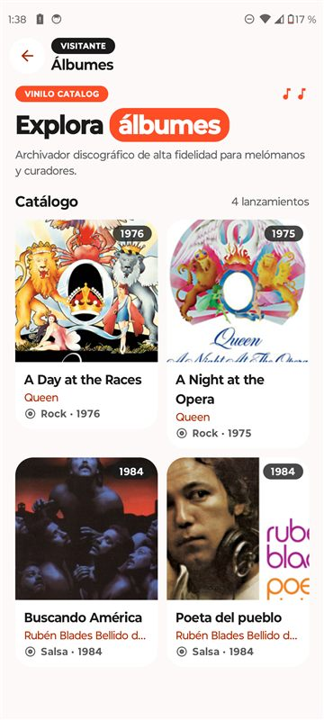 | 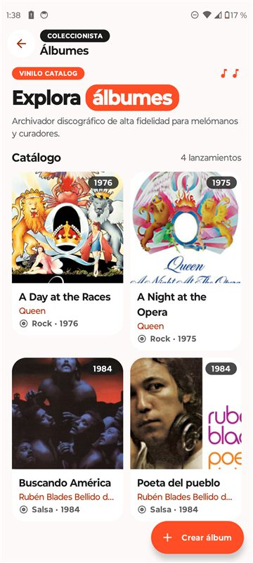 | 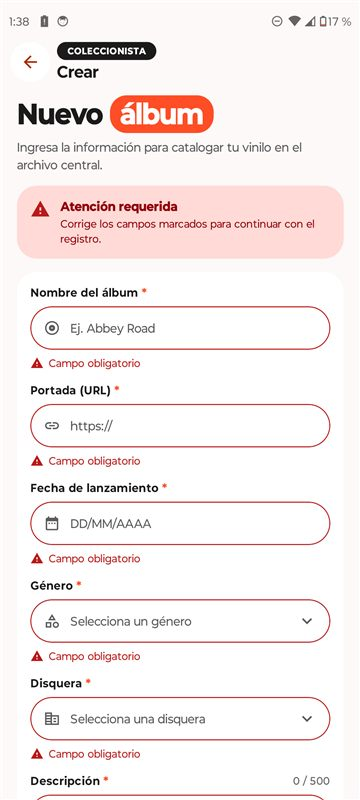 | 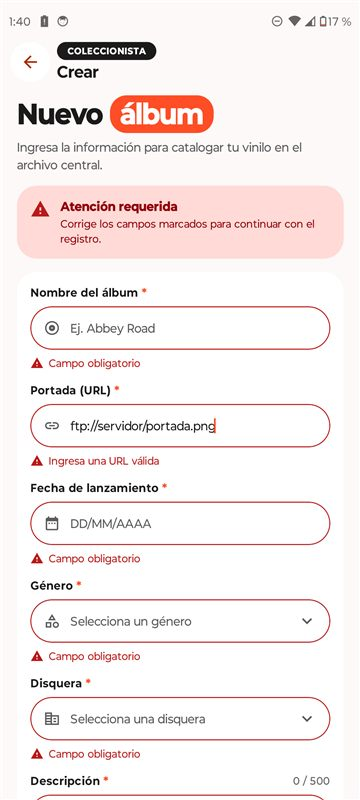 |

| Selector de fecha | Formulario lleno | Creando | Error y reintento |
|---|---|---|---|
| 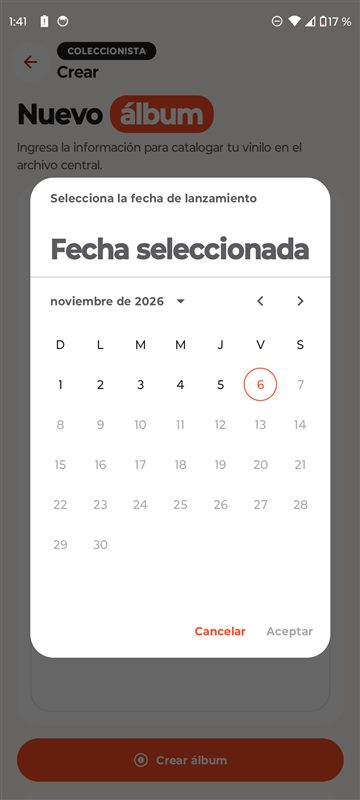 | 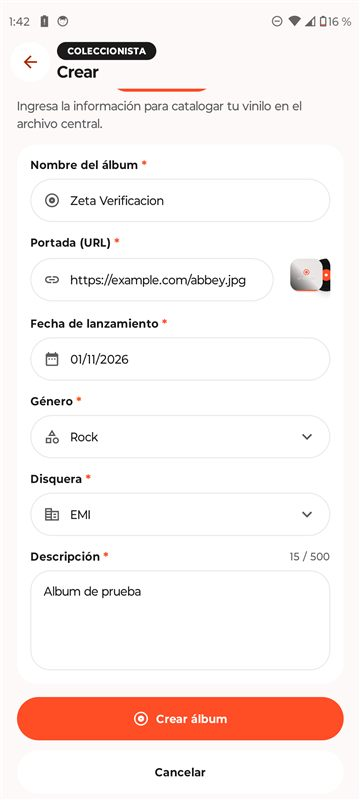 | 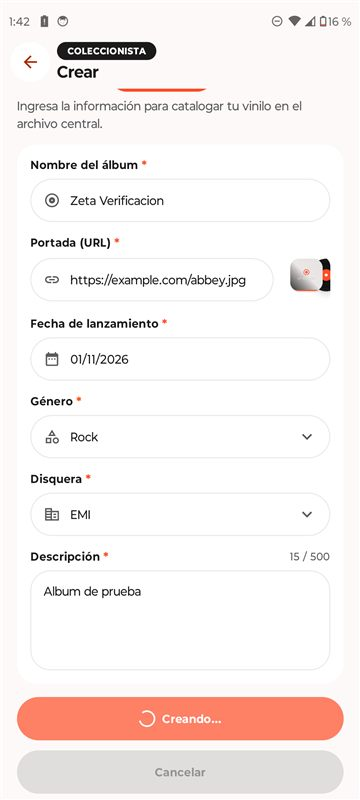 | 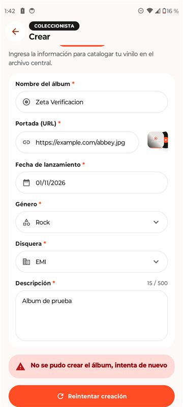 |

| Álbum creado | Insignia NUEVO | Teclado abierto |
|---|---|---|
| 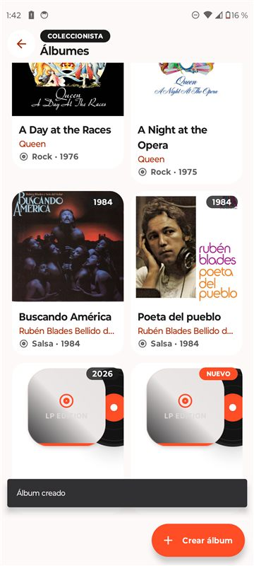 | 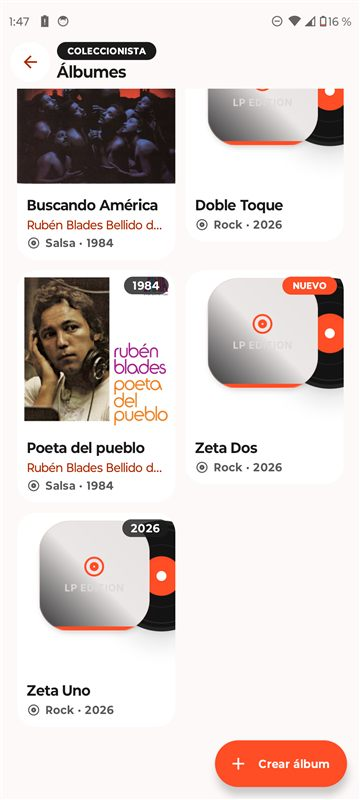 | 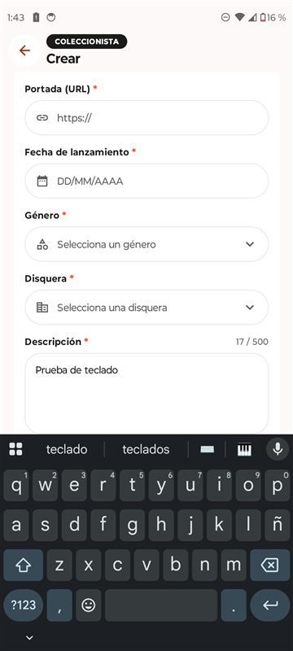 |

| Selector en horizontal (API 23) | Formulario en horizontal |
|---|---|
| 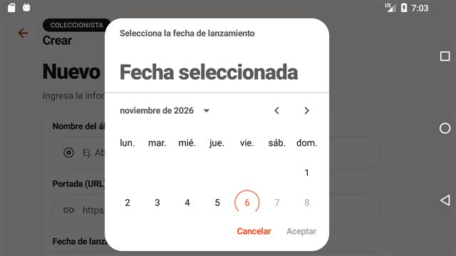 | 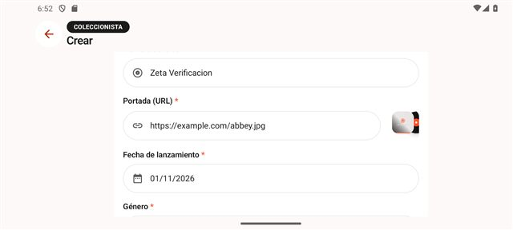 |
