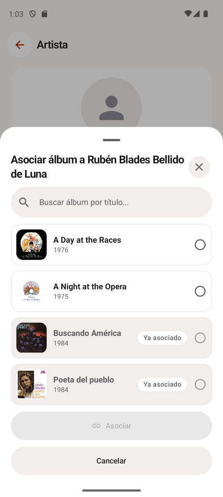
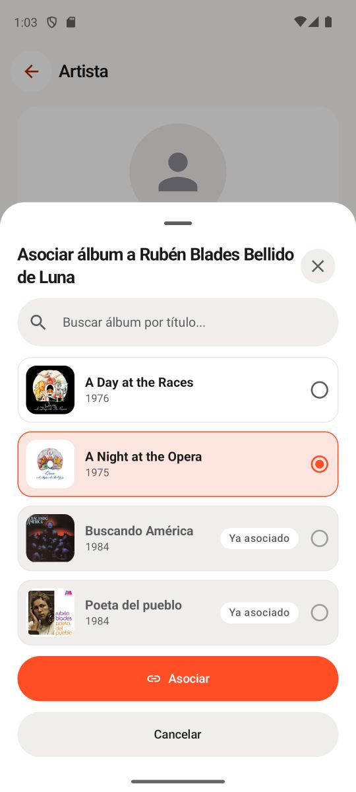
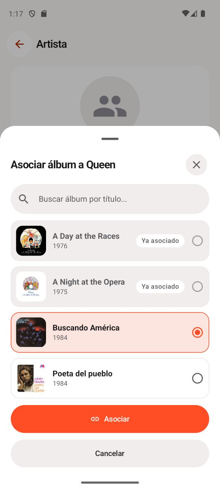
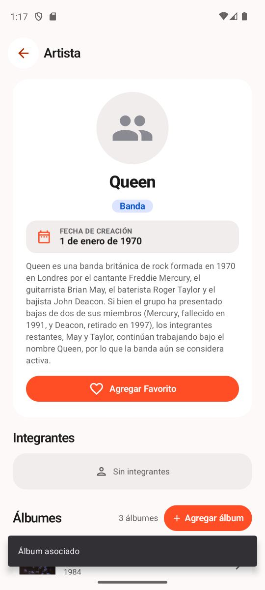
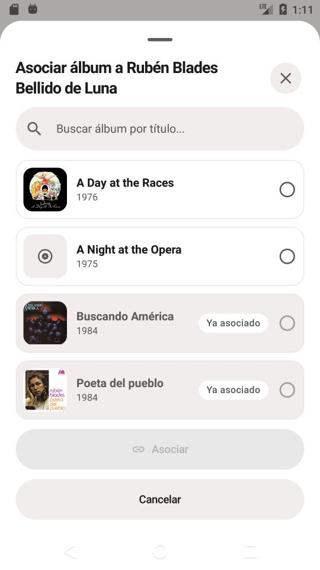

# Resultados: HU15 Agregar un álbum a un artista

Ejecución del 2026-11-19 sobre `feature/hu15-agregar-album-artista`, con el cambio OpenSpec `add-agregar-album-artista`. La implementación se hizo con TDD: en cada ciclo las pruebas se escribieron primero y fallaron (rojo) antes del código (verde), y luego se refactorizó. Las pruebas en dispositivo y el recorrido manual usaron un BackVynils local en Docker, nunca el backend de los tutores. Las pruebas E2E son la tarea T15-5 (#56) y no son parte de este cambio.

## Suites

| Suite | Resultado | Entorno |
|---|---|---|
| Unitarias (`testDebugUnitTest`) | 499 sin fallos (50 nuevas) | JVM |
| Lint (`lint`) | 0 errores; 6 avisos, los mismos de `develop` | JVM |
| Instrumentadas de la HU15 | 29/29 en cada dispositivo, corridas en paralelo | Pixel 8 (API 34), Nexus 5X (API 23) y Motorola Edge 30 |
| Instrumentadas sin E2E (regresión) | 202/202 | Emulador Pixel 8 (API 34) |
| OpenSpec | `openspec validate add-agregar-album-artista --strict` pasa | — |

En el Motorola se usó un APK con `applicationId` `com.example.vinilos.revision` para no reemplazar la app instalada.

### Ciclos de TDD

| Ciclo | Rojo | Verde |
|---|---|---|
| 1. Repositorio: asociar a un músico o a una banda | 14 fallos (`NotImplementedError`) | 13 + 1 pruebas |
| 2. `AsociarAlbumViewModel` | 29 de 31 fallan | 31/31 |
| 3. `ArtistaDetalleViewModel.albumAsociado` | 3 de 5 fallan | 5/5 |
| 4. Ventana y botón "Agregar álbum" | 21 de 25 fallan | 25/25 |
| 5. Integración en `VinilosNavHost` y rotación | 3 de 4 fallan | 4/4 |

Las pruebas que pasaron en rojo comprueban ausencias (por ejemplo, que el Visitante no vea el botón), que ya eran ciertas.

### Pruebas nuevas

| Clase | Pruebas | Qué cubre |
|---|---|---|
| `ArtistRepositoryAsociarTest` | 13 | `POST` del músico; `GET` y `PUT` de la banda con los álbumes actuales más el nuevo; sin `PUT` si no se puede leer la lista completa; 404, 500 y sin conexión como `ErrorDeCarga`; cancelación |
| `RepositoriosDispatcherTest` | 1 | Asociar corre en el dispatcher inyectado |
| `AsociarAlbumViewModelTest` | 34 | Carga con y sin caché, búsqueda, vacío y sin resultados, selección única, ya asociados, asociar, error, reintento, doble toque, cancelar |
| `ArtistaDetalleViewModelTest` | 5 | El álbum se agrega a la discografía por año, aviso, nueva consulta y fallo de esa consulta |
| `VentanaAsociarAlbumTest` | 20 | Un caso por criterio de aceptación, más cargando, error del listado y sin resultados |
| `PantallaDetalleArtistaAsociarTest` | 6 | Botón solo para el Coleccionista, ids enviados al abrir, título con el artista y "Álbum asociado" |
| `VinilosNavHostTest` | 3 | Flujo completo del Coleccionista, cancelar y el Visitante sin botón |
| `RotacionTest` | 1 | Girar con la ventana abierta conserva búsqueda y selección sin volver a consultar |

## Criterios de aceptación

| # | Criterio | Cómo se cumple | Prueba |
|---|---|---|---|
| 1 | Nombre del artista | Título "Asociar álbum a {artista}" | `muestraElNombreDelArtistaAlQueSeLeAgregaElAlbum` |
| 2 | Botón "Agregar álbum" | Junto al título de la sección de álbumes | `elColeccionistaVeAgregarAlbum` |
| 3 | Ventana con búsqueda y álbumes con portada, nombre y año | `ModalBottomSheet`; búsqueda sin tildes ni mayúsculas | `cadaAlbumMuestraPortadaNombreYAnio`, `buscarFiltraPorNombreSinTildesNiMayusculas` |
| 4 | Ya asociados deshabilitados con "Ya asociado" | Fila gris, sin clic | `unAlbumYaAsociadoSeVeDeshabilitadoConLaEtiqueta` |
| 5 | Un solo álbum a la vez | Filas con rol de botón de opción | `soloQuedaSeleccionadoUnAlbum` |
| 6 | "Asociar" deshabilitado sin selección | `puedeAsociar` | `asociarEstaDeshabilitadoSinSeleccion` |
| 7 | Al asociar, "Álbum asociado" | Se cierra la ventana, aviso y discografía actualizada | `elColeccionistaAsociaUnAlbumYLoVeEnLaDiscografiaDelArtista` |
| 8 | "Cancelar" cierra sin cambios | También el botón de cierre, deslizar y atrás | `cancelarCierraLaVentanaSinAsociar` |
| 9 | "No hay álbumes para asociar" | Catálogo vacío o todo ya asociado | `sinAlbumesDisponiblesMuestraElMensaje` |
| 10 | Error: "No se pudo asociar el álbum, intenta de nuevo" con la selección | Ventana abierta y selección intacta | `siFallaAlAsociarMuestraElErrorYConservaLaSeleccion` |
| 11 | El Visitante no ve "Agregar álbum" | El ViewModel y el botón solo existen para el Coleccionista | `elVisitanteNoVeAgregarAlbumEnElDetalleDelArtista` |

## Recorrido contra BackVynils

Contenedor aislado (puerto 3001) con `sql/data.sql`, emulador Pixel 8. Al terminar se recargó `sql/data.sql`.

| Paso | Resultado del backend (`GET /albums`, intérpretes por álbum) |
|---|---|
| Antes | 100: [100], 101: [100], 102: [101], 103: [101] |
| Asociar "Buscando América" (100) a Queen (banda 101) | 100: **[100, 101]**: Rubén Blades se conserva |
| Asociar "A Night at the Opera" (102) a Rubén Blades (músico 100) | 102: **[100, 101]**: Queen se conserva |
| Final | Queen: [100, 102, 103] · Rubén Blades: [100, 101, 102] |

| Captura | Qué muestra |
|---|---|
|  | Ventana del músico: sus dos álbumes "Ya asociado" y "Asociar" deshabilitado |
|  | Un álbum elegido: fila naranja suave y "Asociar" habilitado |
|  | Ventana de la banda Queen con un álbum de otro artista elegido |
|  | "Álbum asociado" y la sección pasa a 3 álbumes |
|  | Nexus 5X (API 23): la lista completa y los botones visibles, sin teclado |

## Defecto encontrado y corregido

| Defecto | Corrección |
|---|---|
| En Android 6 (Nexus 5X) la ventana enfocaba sola la búsqueda y abría el teclado; la lista quedaba sin espacio y una fila se montaba sobre "Asociar" | El foco inicial va al título (que TalkBack anuncia primero). Las pruebas se desplazan hasta la fila que revisan (`TagListaAsociar`) |

## Correcciones de la revisión del PR

Revisión de Daniel Nuñez en el PR #114, corregida con TDD (rojo antes del código).

| Punto | Corrección | Prueba |
|---|---|---|
| **Necesario:** "Asociar" seguía habilitado con un álbum elegido que la búsqueda dejaba fuera, y se asociaba un álbum que no se veía | La selección se quita cuando el álbum deja de verse (búsqueda o catálogo actualizado) y `puedeAsociar` exige que esté visible. Se cambiaron la spec y D4 | 3 nuevas en `AsociarAlbumViewModelTest` (rojo con 3 fallos) |
| TalkBack leía el nombre del álbum dos veces | La portada de la fila es decorativa | `laFilaNoRepiteElNombreConLaDescripcionDeLaPortada` (rojo) |
| `Naranja` fijo en el radio y el borde | `primary`: 2,73:1 hoy sobre `NaranjaSuave` y 4,0:1 con `NaranjaContraste` (#113) | — |
| Dos criterios de orden en la discografía | El álbum se agrega al final y lo ordena la nueva consulta | `albumAsociadoLoAgregaAlFinalDeLaDiscografiaYActivaElAviso` (rojo) |
| `visibles` se recalculaba en cada lectura | `by lazy`, una vez por estado | Las existentes |
| Texto de otra HU | `asociar_cancelar` propio | Las existentes |
| Carrera del `PUT` de bandas | Ya aceptada en `design.md` (*Risks*) | — |

Después de las correcciones: 502 unitarias sin fallos, lint sin errores y 59/59 instrumentadas en el Pixel 8 (`VentanaAsociarAlbumTest`, `PantallaDetalleArtistaAsociarTest`, `VinilosNavHostTest` y `RotacionTest` completas).

## Guía para las pruebas E2E (T15-5, #56)

- **Endpoints que usa la app:** músico con `POST /musicians/{id}/albums/{albumId}`; banda con `GET /bands/{id}` y `PUT /bands/{id}/albums` con la lista completa.
- **Nunca** usar `DELETE /musicians|bands/{id}/albums/{albumId}` para limpiar: le quita **todos** los álbumes al artista. Tampoco `POST /bands/{id}/albums/{albumId}`: deja a la banda como única intérprete del álbum.
- **Datos propios:** crear el álbum de la prueba con `POST /albums` y asociarlo desde la app; al terminar, restaurar con `PUT /musicians/{id}/albums` o `PUT /bands/{id}/albums` y la lista original (nunca vacía: con `[]` el backend le quita todos los álbumes).
- **Error al asociar:** no se puede provocar en el backend real; cubrirlo con `MockWebServer` en la misma clase, como las demás E2E.
- **Tags:** `TagBotonAgregarAlbum`, `TagVentanaAsociar`, `TagListaAsociar`, `tagAlbumAsociable(id)`, `tagYaAsociado(id)`, `TagBotonAsociar`, `TagCancelarAsociar`, `TagErrorAsociar`, `TagVacioAsociar` y `TagSinResultadosAsociar`, en `ui/artistas/VentanaAsociarAlbum.kt`.

## Sin verificar

- Capturas de la ventana girada y con fuente al 200 % para la wiki: el giro está cubierto por `RotacionTest`, pero las capturas quedaron pendientes porque los emuladores pasaron a otra sesión de pruebas.
- `enableAccessibilityChecks()`: necesita la dependencia de #113; al integrarse, agregar la ventana a `AccesibilidadPantallasTest`.
